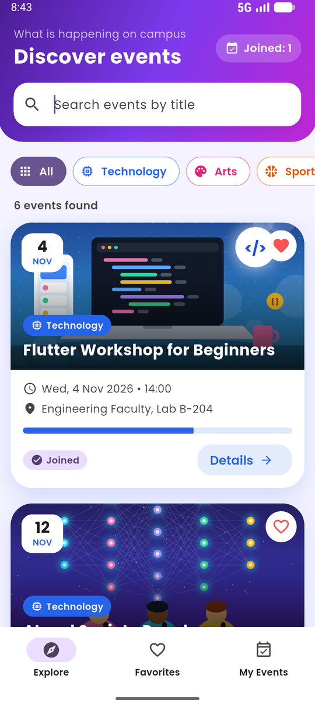
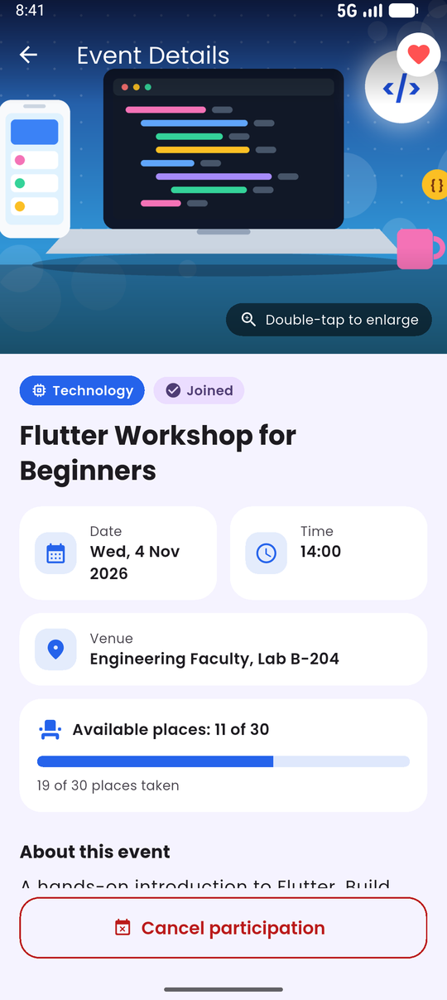
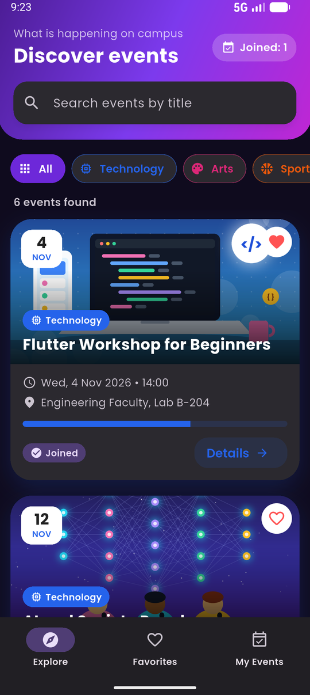
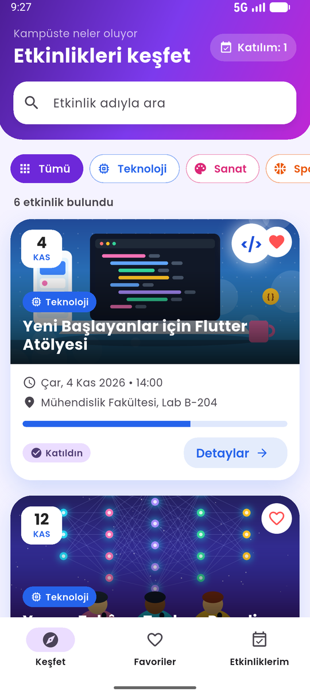
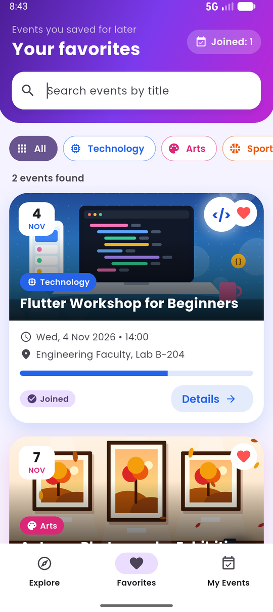
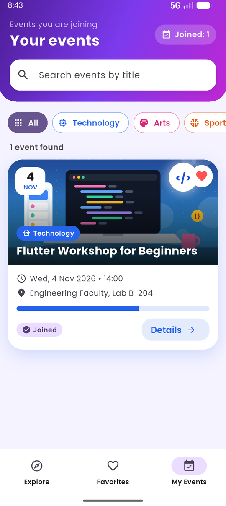
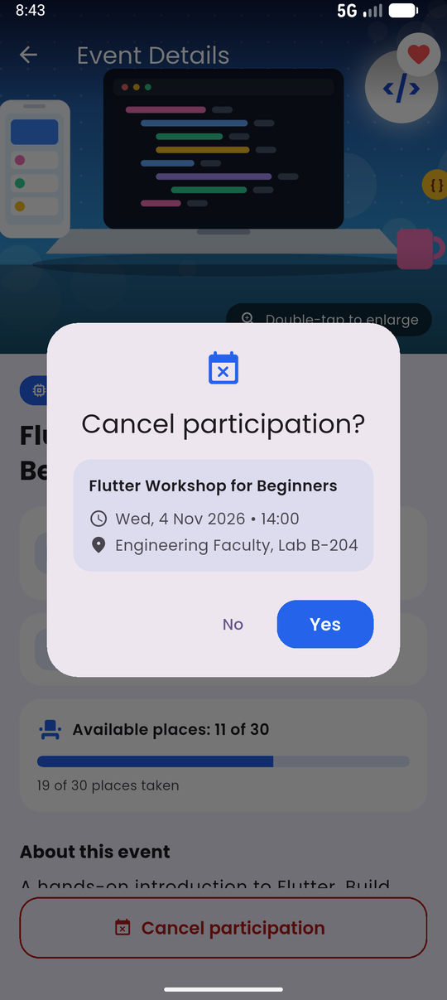
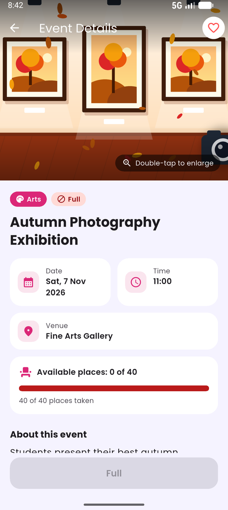
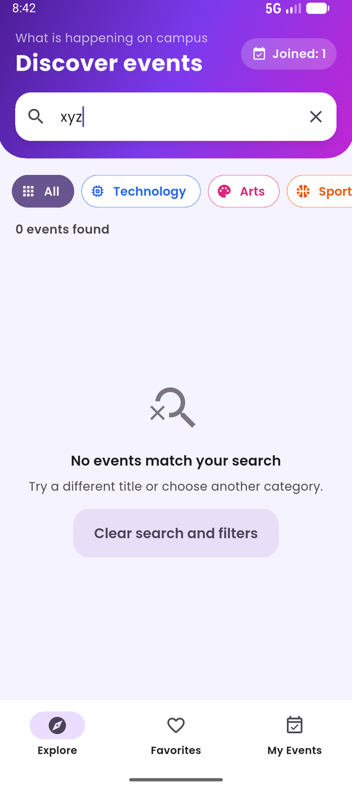

<p align="center">
  
</p>

<h1 align="center">Campus Events</h1>

<p align="center">
  A Flutter app for discovering campus events, saving favorites and managing
  your participation. Works fully offline, in English and Turkish, in light
  and dark mode.
</p>

<p align="center">
  
  
  
</p>

<p align="center">
  
  
  
  
</p>

## Features

- **Explore events**: cards with an illustration, calendar date tile,
  category, time, venue, a capacity bar and a status badge (*places left*,
  *only 1 place left*, *full*, *joined*).
- **Search and filter**: title search that ignores case and surrounding
  spaces, combined with Technology / Arts / Sports filters and a live result
  count. The same filter applies to every tab.
- **Event details**: collapsing image header, date/time/venue tiles,
  capacity card and description. Double-tap the image for a zoomable
  full-screen view.
- **Favorites**: save events with the heart button on a card or on the
  details screen.
- **Join and cancel**: confirmation dialogs show the event's title, time and
  venue. Joining takes exactly one place; cancelling gives it back. Full
  events cannot be joined, but you can always cancel a place you hold.
- **Remembers your choices**: favorites and joined events are saved on the
  device and restored on the next launch.
- **English and Turkish**: follows the phone language, including event texts
  and date formats.
- **Light and dark mode**: follows the phone setting.

## Getting started

Requirements: [Flutter](https://docs.flutter.dev/get-started/install) 3.47.6
(stable) and an Android emulator or device.

```bash
git clone <repository-url>
cd campus_event_explorer
flutter pub get
flutter run
```

Run the checks:

```bash
flutter analyze
flutter test
```

## How it works

- **State:** `HomeScreen` is a `StatefulWidget` that owns the events,
  favorites, joined events and the shared search/category filter. Screens and
  widgets get data and callbacks from it and update with `setState`; no state
  management library is needed at this size.
- **Persistence:** `EventStorage` saves favorite and joined event IDs with
  `shared_preferences`. On start the joined events take their places again,
  so capacities stay consistent.
- **Localization:** UI strings live in `lib/l10n/app_en.arb` and
  `app_tr.arb` (Flutter `gen-l10n`); event texts use a small `LocalizedText`
  type; dates are formatted with `intl` for the current locale.
- **Design:** one theme for light and dark mode (`lib/theme/`), a colour and
  icon per category, and the Poppins font bundled with the app.

## Project structure

```
lib/
  main.dart                      MaterialApp: themes and localization
  models/event.dart              Event, EventCategory, LocalizedText
  data/
    sample_events.dart           Six fictional events (EN + TR)
    event_storage.dart           Saves favorites and joined events
  l10n/                          .arb translations and helpers
  theme/                         App theme, category colours and icons
  screens/
    home_screen.dart             Explore / Favorites / My Events
    event_details_screen.dart    Details, favorite, join/cancel dialogs
    image_viewer_screen.dart     Zoomable full-screen image
  widgets/                       Event card, search bar, badges, ...
  utils/date_format.dart         Locale-aware date/time formatting
assets/
  images/                        Event illustrations
  icon/                          App icon
  fonts/                         Poppins + OFL license
tools/generate_event_images.py   Draws the illustrations and the icon
test/                            Unit and widget tests
```

## Screenshots

| Explore | Details | Favorites | My Events |
|---|---|---|---|
|  |  |  |  |

| Cancel dialog | Full event | No results | Dark mode | Turkish |
|---|---|---|---|---|
|  |  |  |  |  |

## Tests

`flutter test` runs unit and widget tests for:

- sample data rules (unique IDs, a full event, an event with one place left),
- search (case and spaces ignored) combined with the category filter,
- empty states and clearing the search,
- join / cancel dialogs (Yes, No, tapping outside), capacity limits and the
  last-place case,
- favorites staying in sync across tabs and the details screen,
- the double-tap image viewer,
- restoring saved favorites and joined events,
- Turkish language and dark mode.

## Credits

- **Illustrations and app icon:** original artwork drawn for this project by
  [`tools/generate_event_images.py`](tools/generate_event_images.py) (Python +
  Pillow). Regenerate them with `python tools/generate_event_images.py`, then
  update the platform icons with `dart run flutter_launcher_icons`.
- **Font:** [Poppins](https://fonts.google.com/specimen/Poppins) by The
  Poppins Project Authors, bundled under the SIL Open Font License 1.1
  (`assets/fonts/OFL.txt`).

All events in the app are fictional.

## Author

Deniz Aslan
